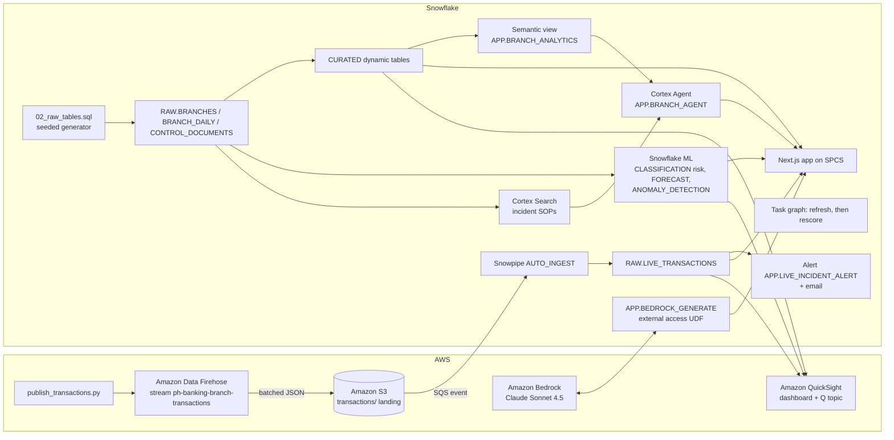

# Philippines Bank Branch Operations - Incidents and Service Risk

End-to-end branch operations for **40 branches of a fictional Philippine retail bank across 5 cities** (Quezon City, Cebu City, Davao City, Iloilo City, Cagayan de Oro) using Snowflake, optionally with AWS: from a live branch incident to a 7-day failed-transaction risk score, an alert email and an AI action memo for the branch operations team.

## Architecture

A branch-operations pipeline built on **Snowflake** (Dynamic Tables, Snowflake ML, Cortex Search, Cortex Agent, Cortex AI_COMPLETE, SPCS) and, in the full build, **AWS** (Amazon Data Firehose, S3, Bedrock Claude, QuickSight + Amazon Q). Branch transaction events land in `RAW.LIVE_TRANSACTIONS`. Dynamic tables curate 90 days of branch-day history: transactions processed, incidents raised (queue overflows, ATM cash-outs, teller system downtime and more), incidents that ended in failed transactions, queue-wait SLA breaches, and cash and ATM audit compliance. Snowflake ML scores 7-day failed-transaction risk per branch, forecasts network-wide incident volume and flags ATM downtime anomalies. A Cortex Agent answers questions with SOP citations, and an LLM drafts the operations action memo.

Interactive diagrams (hover for object names): [Snowflake only](docs/architecture-snowflake.html) | [AWS + Snowflake](docs/architecture-aws.html). The app shows both on its Architecture & Data tab, the current build first. Regenerate them with `python3 docs/build_architecture.py`.



The Snowflake-only build drops the AWS subgraph: `APP.SIMULATE_TRANSACTIONS` writes to `RAW.LIVE_TRANSACTIONS`, and the app calls Cortex `AI_COMPLETE` instead of the Bedrock UDF.

## Snowflake Capabilities

| Capability | Implementation |
|-----------|---------------|
| Dynamic Tables | `CURATED.KPI_SUMMARY`, `PERFORMANCE_SUMMARY`, `INCIDENT_SUMMARY`, `TREND_ANALYSIS` from the RAW tables |
| Snowflake ML | CLASSIFICATION 7-day failed-transaction risk (`ML.FAILURE_RISK_SCORES`), 14-day incident-volume FORECAST, ATM downtime ANOMALY_DETECTION |
| Cortex Search | 13 synthetic incident-handling SOPs (one per branch format and incident type) in `SEARCH.INCIDENT_SOP_SEARCH` |
| Semantic View | `APP.BRANCH_ANALYTICS` over branches, incident types, daily totals and risk |
| Cortex Agent | `APP.BRANCH_AGENT`: Cortex Analyst over the semantic view plus Cortex Search for SOP citations |
| Cortex AI | `AI_COMPLETE('claude-sonnet-4-5')` for grounded answers, and for the action memo in the Snowflake-only build |
| Alerts + Tasks | `APP.LIVE_INCIDENT_ALERT` logs INCIDENT events and sends email; task graph `TASK_REFRESH_CURATED`, then `TASK_RESCORE_RISK` |
| Snowpark Container Services | Next.js app `APP.PH_BANKING_BRANCH_APP` with 6 tabs: Executive Cockpit, Predictive, Controls, Live Transactions, Ask AI, Architecture & Data |
| Snowpipe | `RAW.LIVE_TRANSACTIONS_PIPE` AUTO_INGEST from S3 (AWS build only) |

## AWS Services

Used only in the AWS + Snowflake build.

| Service | Role in Demo |
|---------|-------------|
| Amazon Data Firehose | Direct PUT stream `ph-banking-branch-transactions` receives simulated branch transaction events and writes batches to S3 |
| Amazon S3 | Landing bucket (`transactions/`). An event notification goes to the Snowpipe SQS queue |
| Amazon Bedrock | Claude Sonnet 4.5 writes the action memo, called from Snowflake through an external-access UDF |
| Amazon QuickSight | DIRECT_QUERY executive dashboard over Snowflake (daily incidents, failed transactions by branch, failed-transaction risk) |
| Amazon Q | Natural-language questions over the QuickSight topic `ph-banking-branch-topic` |
| AWS IAM | Least-privilege roles for S3, Firehose and Bedrock |

## Personas

These personas are fictional.

| Persona | Role | Key Questions |
|---------|------|---------------|
| **Marisol Dela Paz** | Head of Branch Operations | "Which incident types end in failed transactions?" "Which cities need field-support capacity next fortnight?" |
| **Ramon Villanueva** | Area Operations Analyst | "Which branches are high risk this week, and which SOP applies?" |

## Data

All data is synthetic and seeded, so every rebuild reproduces it. The bank, branches and names are fictional.

| Table | Rows | Description |
|-------|------|-------------|
| RAW.BRANCHES | 40 | Branches in 5 Philippine cities and 5 formats (Full-service branch, Mall branch, Business centre, Micro branch, Off-site ATM hub), with risk tier and branch age |
| RAW.BRANCH_DAILY | 3,600 | Daily branch observations over 90 days: transactions, value (PHP), incidents, failed-transaction incidents, queue SLA breaches, incident type, cash and ATM audits, ATM downtime and average queue wait |
| RAW.CONTROL_DOCUMENTS | 40 | Required, on-file and pending branch control documents per branch |
| SEARCH.INCIDENT_DOCS | 13 | Synthetic incident-handling SOPs indexed for Cortex Search |
| RAW.LIVE_TRANSACTIONS | Grows during the demo | Live branch transaction events from Firehose (AWS build) or `APP.SIMULATE_TRANSACTIONS` (Snowflake-only build) |
| ML.FAILURE_RISK_SCORES | 40 | 7-day failed-transaction probability and risk band per branch |
## Build Instructions

### Prerequisites
- Snowflake account with ACCOUNTADMIN access, and Cortex AI enabled (AI_COMPLETE, Search, Agent).
- An X-Small warehouse with auto-suspend at or below 120 s, and an existing SPCS compute pool.
- Python 3.11+, `snowflake-connector-python`, Node.js 22+, Docker and the `snow` CLI.
- App image: run `snow spcs image-registry login`, then build and push `ph-banking-branch-app:v1` to the database's `APP.IMAGES` repository (see the header of `snowflake/07_deploy_app.sql`).
- AWS build only: `boto3`, AWS credentials for the target account (us-west-2) with Bedrock access, and QuickSight Enterprise.

### SPCS App
```
<DATABASE>.APP.PH_BANKING_BRANCH_APP
```

### Tests
```bash
python -m pytest aws snowflake quicksight
```

For a local run, put `SNOWFLAKE_ACCOUNT`, `SNOWFLAKE_USER`, `SNOWFLAKE_DATABASE`, `SNOWFLAKE_WAREHOUSE`, `SNOWFLAKE_AUTHENTICATOR=PROGRAMMATIC_ACCESS_TOKEN`, `SNOWFLAKE_TOKEN` and `DEMO_PLATFORM` in the environment, then run `npm --prefix app run build && npm --prefix app start`.

## Build Modes

Both modes share the same core. They differ in three places, and the app's `DEMO_PLATFORM` setting (in its SPCS spec) switches the memo provider and the Live Transactions tab.

| Layer | Snowflake Only | Full AWS + Snowflake |
|---|---|---|
| Live transactions | `CALL APP.SIMULATE_TRANSACTIONS(n)` inserts simulated branch transaction events into `RAW.LIVE_TRANSACTIONS`. This simulates a branch transaction feed; it is not Snowpipe Streaming | `aws/publish_transactions.py` to Amazon Data Firehose, then S3, SQS and Snowpipe AUTO_INGEST |
| Action memo | Cortex `AI_COMPLETE('claude-sonnet-4-5')` | Amazon Bedrock Claude Sonnet 4.5 through `APP.BEDROCK_GENERATE` |
| BI and natural-language questions | The SPCS app is the dashboard; questions go to the Cortex Agent | Also a QuickSight dashboard and an Amazon Q topic |
| App setting | `DEMO_PLATFORM: snowflake` | `DEMO_PLATFORM: aws` |

### Snowflake Only

```bash
# 1. Core data and dynamic tables (guarded: new isolated database only)
python snowflake/run_core.py --database PHILIPPINES_BANKING_BRANCH_SNOWFLAKE --warehouse <XS_WAREHOUSE> --connection <CONNECTION> --apply
# 2. Native transaction feed, ML, search, semantic view, agent, alert and task graph
python snowflake/run_intelligence.py --database PHILIPPINES_BANKING_BRANCH_SNOWFLAKE --platform snowflake --warehouse <XS_WAREHOUSE> --connection <CONNECTION> --alert-email you@example.com
# 3. App on SPCS with DEMO_PLATFORM=snowflake (push the image first)
python snowflake/run_intelligence.py --database PHILIPPINES_BANKING_BRANCH_SNOWFLAKE --platform snowflake --warehouse <XS_WAREHOUSE> --connection <CONNECTION> --alert-email you@example.com --files 07_deploy_app.sql --compute-pool <COMPUTE_POOL>
```

During the demo:
- Run `CALL APP.SIMULATE_TRANSACTIONS(20)` to add live branch transaction events. For a continuous feed, run `ALTER TASK APP.TASK_SIMULATE_TRANSACTIONS RESUME`, and `SUSPEND` it afterwards.
- Run `EXECUTE ALERT APP.LIVE_INCIDENT_ALERT` to raise the alert email.
- Run `EXECUTE TASK APP.TASK_REFRESH_CURATED` to refresh the curated tables and rescore risk.

Afterwards, drop the database or run `ALTER SERVICE APP.PH_BANKING_BRANCH_APP SUSPEND`.

### Full AWS + Snowflake

```bash
# 1. Core data and dynamic tables (guarded: new isolated database only)
python snowflake/run_core.py --database PHILIPPINES_BANKING_BRANCH_AWS --warehouse <XS_WAREHOUSE> --connection <CONNECTION> --apply
# 2. AWS ingestion and Bedrock (dry run first, then --apply)
python aws/setup_aws.py --database PHILIPPINES_BANKING_BRANCH_AWS --account <AWS_ACCOUNT_ID> --connection <CONNECTION> --apply
# 3. ML, search, semantic view, agent, alert and task graph
python snowflake/run_intelligence.py --database PHILIPPINES_BANKING_BRANCH_AWS --platform aws --warehouse <XS_WAREHOUSE> --connection <CONNECTION> --alert-email you@example.com
# 4. App on SPCS with DEMO_PLATFORM=aws (push the image first)
python snowflake/run_intelligence.py --database PHILIPPINES_BANKING_BRANCH_AWS --platform aws --warehouse <XS_WAREHOUSE> --connection <CONNECTION> --alert-email you@example.com --files 07_deploy_app.sql --compute-pool <COMPUTE_POOL>
# 5. QuickSight dashboard and Q topic (needs an existing Snowflake data source)
python quicksight/build_dashboards.py --database PHILIPPINES_BANKING_BRANCH_AWS --account <AWS_ACCOUNT_ID> --principal-arn <QUICKSIGHT_USER_ARN> --data-source-arn <DATA_SOURCE_ARN> --prefix ph-banking-branch --apply --update --with-topic
```

QuickSight objects must be shared with the QuickSight user who signs in (`--principal-arn`); otherwise the console shows nothing.

During the demo:
- Run `python aws/publish_transactions.py --count 20` to send live branch transaction events. Firehose buffers for up to 60 seconds before writing to S3.
- Run `EXECUTE ALERT APP.LIVE_INCIDENT_ALERT` to raise the alert email.
- Run `EXECUTE TASK APP.TASK_REFRESH_CURATED` to refresh the curated tables and rescore risk.

Afterwards, `python aws/teardown_aws.py --database PHILIPPINES_BANKING_BRANCH_AWS --account <AWS_ACCOUNT_ID> --connection <CONNECTION> --apply` removes the AWS resources and the account-level Bedrock external-access and S3 storage integrations. It leaves the email integration `PH_BANKING_BRANCH_EMAIL_INT`, which the Snowflake-only build also uses.

## Business Impact

Industry research and Snowflake customer outcomes:
- **Account ownership in the Philippines**: account ownership surged to 56 percent in 2021, up from 29 percent in 2019, and the share of adults with a bank account almost doubled to 23 percent in 2021 from 12 percent in 2019 -- [Bangko Sentral ng Pilipinas, More than 50% of Filipinos Now Own a Financial Transaction Account (2022)](https://www.bsp.gov.ph/SitePages/MediaAndResearch/MediaDisp.aspx?ItemId=6416)
- **Cash still matters**: the same survey found that over half of savers still keep their money at home -- [Bangko Sentral ng Pilipinas, More than 50% of Filipinos Now Own a Financial Transaction Account (2022)](https://www.bsp.gov.ph/SitePages/MediaAndResearch/MediaDisp.aspx?ItemId=6416)
- **NatWest** (Snowflake customer), one of Britain's largest retail and commercial banks, reports an "80% reduction in total cost of ownership and carbon footprint" for its ESG analytics on Snowflake -- [Snowflake customer story: NatWest](https://www.snowflake.com/en/customers/all-customers/case-study/natwest/)

## Key Demo Numbers

These figures are synthetic and come from the seeded demo data. Forecast and anomaly figures can shift slightly with the build day.

- **40 branches** in 5 cities across 5 formats, 3,600 branch-days over 90 days; **3,328,765 transactions** worth PHP 25,115 M
- **Incident-free transaction rate 99.98%**: **586 incidents** raised, of which **163** ended in failed transactions (incident failure rate 27.8%); **86 queue SLA breaches**
- **Queue overflow** produces the most failed-transaction incidents (54 of 143 incidents); the 16 area power interruption incidents always resolve without a failed transaction
- **Failed-transaction model** out-of-time holdout: precision 0.43, recall 0.40 at a 0.5 threshold, against a 0.185 base rate. Nine branches are high risk; the top branch is BR-0035, at 93.6%
- **14-day incident forecast** with prediction intervals; **29 of 640** branch-days flagged as ATM downtime anomalies
- **Cash audit compliance 77.9%**, branch control document coverage 61.6%, with 29 documents pending
- **13 SOPs** indexed for Cortex Search and cited by ID in agent answers

## License

Apache 2.0 — See [LICENSE](LICENSE) for details.

This is a personal demo project and is not an official Snowflake offering. It comes with no support or warranty. Industry metrics cited are from publicly available third-party research and Snowflake customer stories; they represent reported outcomes and are not guarantees of results.
